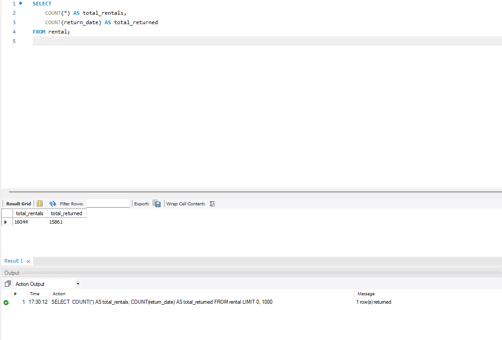
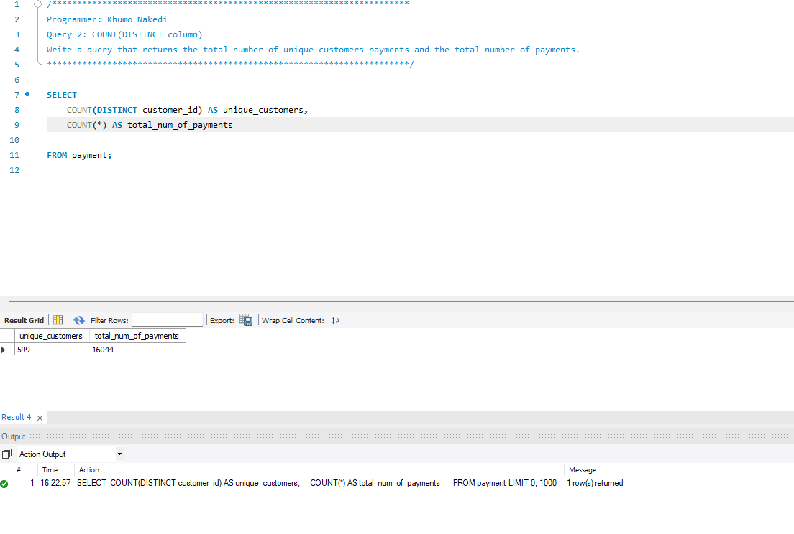
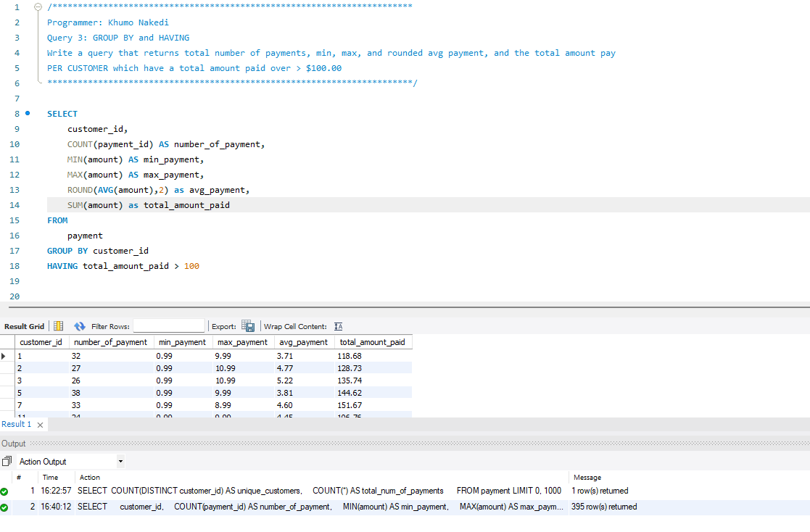
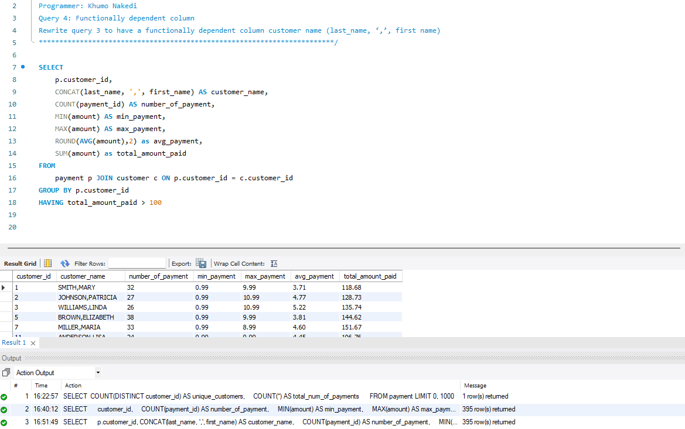
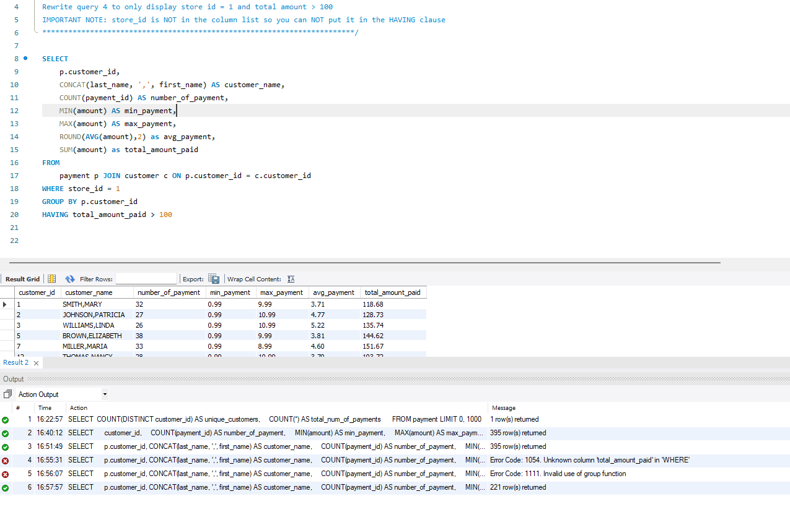
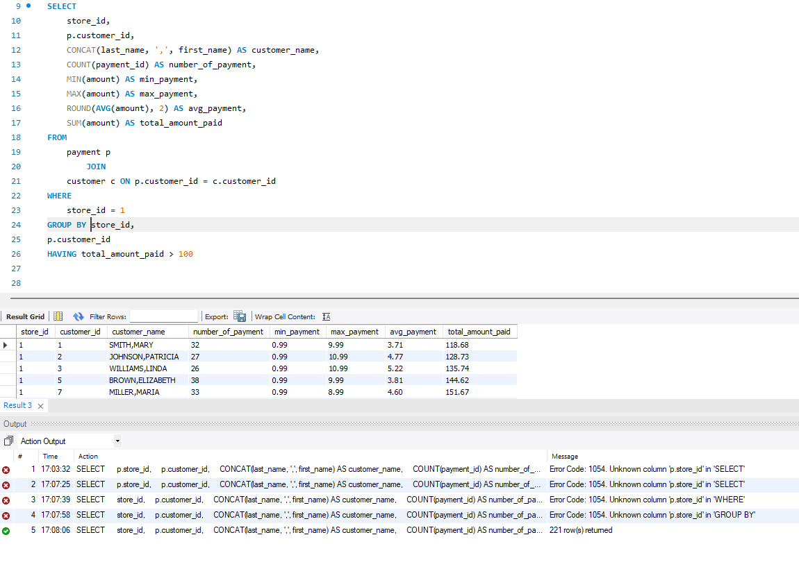
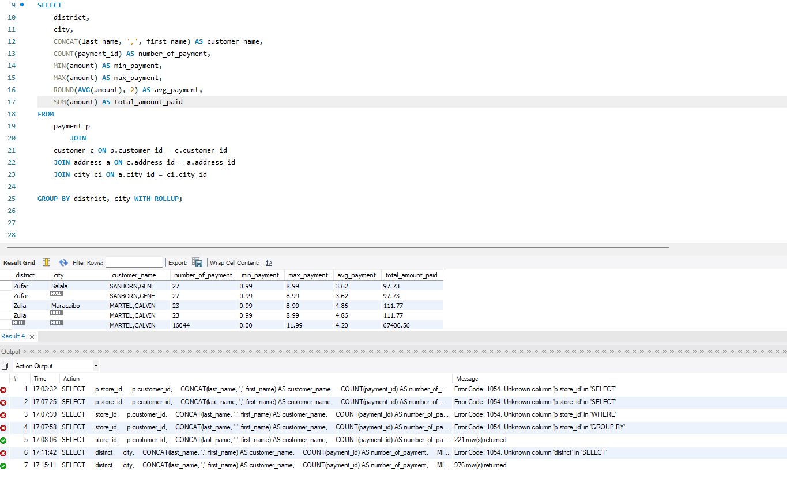
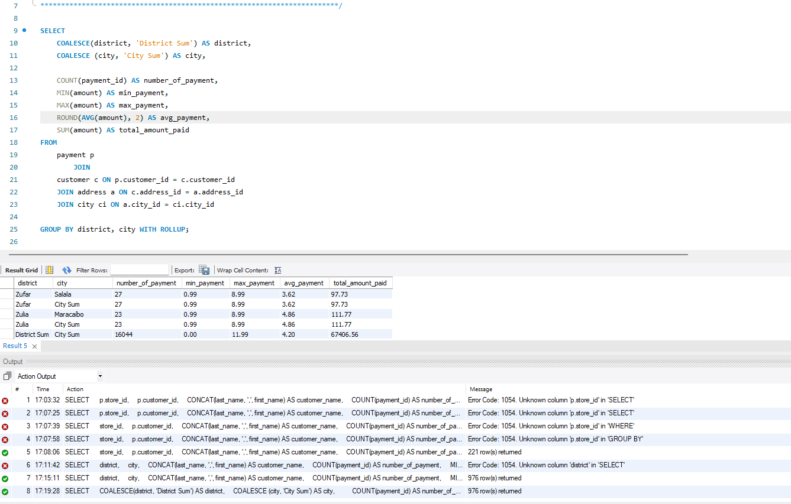

# mySQL_Chapter6_Queries

## Table of Contents
- [Summary](#summary)
- [Collaborator](#collaborator)
- [New Concepts Used](#new-concepts)

- [Query 1: COUNT](#query-1)
- [Query 2: COUNT DISTINCT](#query-2)
- [Query 3: GROUP BY and HAVING](#query-3)
- [Query 4: Functionally Dependent Column](#query-4)
- [Query 5: WHERE vs HAVING - Part 1](#query-5)
- [Query 6: WHERE vs HAVING - Part 2](#query-6)
- [Query 7: WITH ROLLUP](#query-7)
- [Query 8: GROUPING and COALESCE Functions](#query-8)

---

## Summary

This project covers Chapter 5 of MySQL, focusing on inserting, updating, deleting, and backing up data within a relational database.

The exercises use the Sakila database to demonstrate how SQL statements can manage records, create backup tables, modify customer information, and maintain relationships between tables.

Screenshots of MySQL Workbench queries and results are included to document each exercise.

## Collaborator

**Khumo Nakedi**

GitHub: [@nakediKhumo03](https://github.com/nakediKhumo03)

## New Concepts Used

## New Concepts Used

- COUNT()
- COUNT(DISTINCT column)
- MIN(), MAX(), AVG(), SUM()
- GROUP BY
- HAVING
- Functionally dependent columns
- WHERE vs HAVING
- WITH ROLLUP
- GROUPING and COALESCE functions
---

## Query 1

## Query 2

## Query 3

## Query 4

## Query 5

## Query 6

## Query 7

## Query 8

